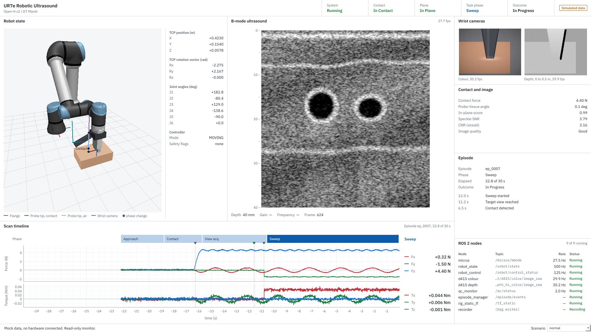

# usrig_demo_gui

Demo and monitoring screen for the UR7e robotic ultrasound rig (Open-H v2, IIT Mandi).

It only **shows** things: robot state, B-mode image, wrist cameras, force/torque, the episode
(task phase, events, contact and image quality) and node health (recording status optional). It has no buttons that move the robot, start or stop
recording, or send anything to ROS. Robot motion stays with `robot_control` / `episode_manager`,
and the operator view during collection stays `status_console` / `usrig_dashboard operator_console`.

**Demos only, never during dataset collection.** In ROS mode the GUI watches `/episode/status` and
the ROS graph (read-only). While `episode_manager` runs a real (non-sim) session, it destroys every
display subscription and shows a "paused" page; it resumes by itself when that session ends or for a
`sim:=true` session. Rule and reasons: `usrig_demo_gui/collection_guard.py`.

Without arguments it runs on **mock data** (no ROS, no hardware). `--source ros` (or
`collect.launch.py demo_gui:=true`) uses the read-only ROS 2 adapter; its collection guard has been
run against a live ROS 2 graph, but the topic mapping has not yet been checked on the rig (see
`docs/INTEGRATION.md`).



## Why PySide6

The repo's existing dashboard (`src/usrig_dashboard`) is PySide6 + pyqtgraph with rclpy in a worker
thread, and `environment.yml` already pins `PySide6-Essentials==6.8.3` and `pyqtgraph`. This package
uses the same stack and the same patterns (best-effort keep-last-1 subscriptions, GUI redraws on its
own timer), so nothing in the existing packages was changed. The only new dependency is PyOpenGL
for the 3D robot (see below), and the GUI still runs without it.

## Look and layout

```
+------------------------+------------------------+-----------------+
| Robot (3D + map)       | B-mode ultrasound      | Wrist cameras   |
|                        |                        | Contact & image |
+------------------------+------------------------+ Episode         |
| Scan timeline: phase band, force, torque        | ROS 2 nodes     |
+-------------------------------------------------+-----------------+
```

- Organised by time, not by sensor: the scene (where the probe is, what it sees) on top, and one
  **scan timeline** underneath where the task phases, events, force and torque share a single
  time axis (last `force_window_s` = 30 s). Each event is a tick on the phase band and a faint
  line through the force and torque plots, so a force change can be read against its cause.
- Secondary readouts (wrist cameras, contact and image quality, episode and recent events, node
  health, optional recording) sit in the right rail.
- Light theme: white panes on a light grey frame, near-black text; blue for the probe and the
  current phase; green / orange / red / grey only for status. The B-mode and camera images keep
  their own pixel values.
- Type: IBM Plex Sans with tabular digits (bundled in `assets/fonts`, SIL Open Font License), IBM
  Plex Mono only for ROS topic names and paths. Sentence-case labels; explanations in tooltips.
- On narrower windows (< 1400 px) the rail becomes two columns under the timeline.

## 3D robot

The robot is drawn with the official Universal Robots meshes from
[Universal_Robots_ROS2_Description](https://github.com/UniversalRobots/Universal_Robots_ROS2_Description)
(BSD-3-Clause, licence in `usrig_demo_gui/assets/`). The UR7e uses the UR5e meshes and the same
kinematics there; the joint chain in `kinematics.urdf_frames()` is taken from
`config/ur7e/default_kinematics.yaml` and is checked against the DH chain in the tests.
`tools/build_ur_meshes.py` regenerates `assets/ur7e_meshes.npz` from a checkout of that repo.

Rendering uses OpenGL through pyqtgraph and needs PyOpenGL:

```bash
pip install PyOpenGL          # inside the openh conda env (or: sudo apt install python3-opengl)
```

**Trajectory map.** The robot view shows how the tool moved from the rest position to the scan
and back: the paths of the **flange** (end effector, purple), the **probe tip** (dark blue in
contact, light blue in air) and the **wrist camera** (teal, with the camera body drawn at its
pose), plus a dot and label at the rest position and at every task-phase change.

- A run starts when the robot leaves a rest (stationary for `trajectory.rest_s` with no episode
  running), so the map covers rest -> approach -> contact -> scan -> retract. The last run stays
  on screen while the robot is parked and is replaced when it moves off again.
- The paths come from the topics, not from the GUI's own kinematics: the controller TCP pose
  (`/robot/tcp_pose`, same sample as `tcp_base` in `/robot/state`) combined with the rig
  calibration: flange = TCP x inv(`robot.tcp_setting`); probe tip = TCP if
  `probe.tcp_already_includes_probe`, else flange x `probe.tip_offset_flange_m`; wrist camera =
  flange x hand-eye (`flange -> wrist_camera` on `/tf_static` from `rig_static_tf`, else
  `calibration.wrist_cam_cali_mtx`). Phase markers come from `/episode/events`.
- These calibrations are `null` in the repo today. A path whose calibration is missing is not
  drawn; the legend shows it as "(not calibrated)" and its tooltip names the `rig.yaml` entry
  needed. The mock uses stand-in values (`mock.rig` in `config/demo_gui.yaml`), so all three paths
  appear in the simulated scenarios only.

Code: `frames.py` (tool frames from TCP + calibration), `trajectory.py` (runs, markers).

`--robot-view auto` (default) uses the meshes when OpenGL loads and otherwise falls back to a simple
line drawing; `--robot-view simple` forces the line drawing (e.g. on a PC without GPU drivers, where
software OpenGL is slow). The probe and holder are simple boxes, since the real holder geometry and
TCP offset are not in the repo yet.

## Run it

Inside the repo:

```bash
source ~/OpenH/scripts/env.sh
scripts/build.sh                      # or: colcon build --packages-select usrig_demo_gui
ros2 run usrig_demo_gui demo_gui                      # mock data, scenario "normal"
ros2 run usrig_demo_gui demo_gui --scenario recovery
ros2 run usrig_demo_gui demo_gui --fullscreen         # for the lab monitor
ros2 run usrig_demo_gui demo_gui --source ros         # live rig, read-only (or collect.launch.py demo_gui:=true)
```

Without ROS at all (any machine with Python 3.10+):

```bash
pip install "PySide6-Essentials==6.8.3" pyqtgraph "numpy<2" pyyaml PyOpenGL
cd usrig_demo_gui
python -m usrig_demo_gui --scenario normal
```

Options: `--scenario`, `--size 1920x1080`, `--fullscreen`, `--robot-view auto|gl|simple`,
`--config path/to/demo_gui.yaml`, `--screenshot out.png --after 10` (saves the window and exits;
handy for slides).

The mock scenario can also be switched from the drop-down in the bottom bar. That control only
changes the fake data; it is hidden when running on ROS.

### Mock scenarios

| scenario | what you see |
|---|---|
| `normal` | full episode looping: approach, contact, view acquisition, sweep, reacquisition, success |
| `idle` | robot parked above the phantom, no episode, probe in air (dark image, reverberations) |
| `degraded` | episode running but B-mode at 18 fps and depth at 9 fps, QC warnings, system Degraded |
| `disconnected` | nothing publishing: every stream disconnected, nodes down, values n/a |
| `recovery` | staged lift perturbation during the sweep, contact lost and regained, ends in success |
| `success` | same as normal but starts near the end so the Success outcome shows quickly |
| `failure` | drift out of plane, lift-off, view never reacquired, 30 s cap reached, Failure |
| `aborted` | operator discards the episode during view acquisition |

## Tests

```bash
PYTEST_DISABLE_PLUGIN_AUTOLOAD=1 QT_QPA_PLATFORM=offscreen python -m pytest -q src/usrig_demo_gui/test
```

32 tests: the collection guard (paused during a real session, live again after; header while paused), the episode output path, kinematics (DH and URDF chains agree), the mesh asset, the tool-frame chain, the
trajectory map (rest detection, runs, markers), the scan timeline, metrics, every mock scenario,
state semantics (lost contact is not a failure), the episode-event mapping, the ROS adapter mapping
fed with fake messages, and an offscreen build of the window at wide and narrow sizes. The OpenGL
test needs a display and is skipped otherwise (run it with `xvfb-run` on a headless machine).
Checked on Python 3.10 / numpy 1.26 / PySide6 6.8.3 (same as `environment.yml`) and on
Python 3.13 / numpy 2.

## Layout of the code

```
usrig_demo_gui/
  config/demo_gui.yaml        node list, topic names, thresholds, phase/outcome maps, mock settings
  usrig_demo_gui/
    app.py                    entry point (argument parsing, picks mock or ros source)
    main_window.py            header + panel grid, wide/narrow arrangement, refresh timer
    models.py                 typed data the panels draw (DashboardState and friends)
    theme.py                  colours, sizes, font, stylesheet
    kinematics.py             UR7e FK (DH and URDF chains) for drawing, small IK used by the mock
    frames.py                 flange / probe tip / wrist camera from the TCP pose + rig calibration
    trajectory.py             trajectory map: runs from the rest position, phase markers
    assets/                   UR7e meshes (from ur_description) and their licence
    metrics.py                speckle SNR, CNR, coupling mean (None when undefined)
    sources/
      base.py                 DataSource interface: snapshot() -> DashboardState
      mock.py                 scripted scenarios
      mock_images.py          synthetic B-mode / RGB / depth frames
      episode_tracker.py      /episode/events -> phase, outcome, recording, event log
      ros_source.py           read-only ROS 2 adapter (not yet checked on the rig)
    collection_guard.py       demo only: paused while episode_manager runs a real session
    widgets/
      header.py               DashboardHeader
      robot_view_gl.py        3D view with the UR meshes (OpenGL)
      robot_view.py           fallback line drawing of the arm (QPainter, no OpenGL)
      panels.py               RobotStatePanel, UltrasoundPanel and the rail: WristCamerasPanel,
                              QualityPanel, EpisodeInfoPanel, RecordingStatusPanel, ROSNodeHealthPanel
      timeline.py             TimelinePanel: phase band, force, torque on one time axis
      common.py               Panel, label/value list, status dot, elided label, image view
  tools/build_ur_meshes.py    regenerates assets/ur7e_meshes.npz
  test/test_demo_gui.py
  docs/INTEGRATION.md         where real data enters each panel
```

Panels never talk to ROS. Each one has `update_state(DashboardState)`; a source fills
`DashboardState`. Swapping mock for ROS (or for a bag replay later) does not touch the panels.

## Assumptions (please check)

- **UR7e geometry.** The UR description package gives the UR7e the same kinematics and meshes as
  the UR5e. Used only to draw the arm and for the mock IK; the TCP numbers in ROS mode come from
  the controller, not from this FK.
- **Probe length 0.13 m** for drawing (`rig.yaml robot.tcp_setting` is still null).
- **Node / topic names** in `demo_gui.yaml` are taken from the repo's launch files and nodes. The
  RealSense ones depend on `camera_namespace` / `camera_name` and the repo itself marks them for
  confirmation with `ros2 topic list`.
- **Plane state** is always Unknown on ROS: there is no plane estimator in the repo yet. In mock
  mode it comes from the scripted timeline.
- **Contact** on ROS needs `contact_force_threshold_n` in the config. It is null, so contact shows
  Unknown until someone measures and sets it (same rule as `rig.yaml`).
- **Phase mapping** from `episode_manager` phase names to the GUI's six phases is in
  `phase_map`. `episode_manager` has no explicit "sweep" event; `path: sweep` is a placeholder.
- **Outcome mapping**: `recovered` is shown as Success (with an event line), `discard` as Aborted.
- Scan metrics are display aids. Probe-tissue angle, in-plane score and CNR are mock-only for now
  and are labelled that way; on ROS they show n/a.
- Frame rates in mock mode are the simulated device rates. The GUI's own redraw rate is in the
  tooltip of the bottom bar.
